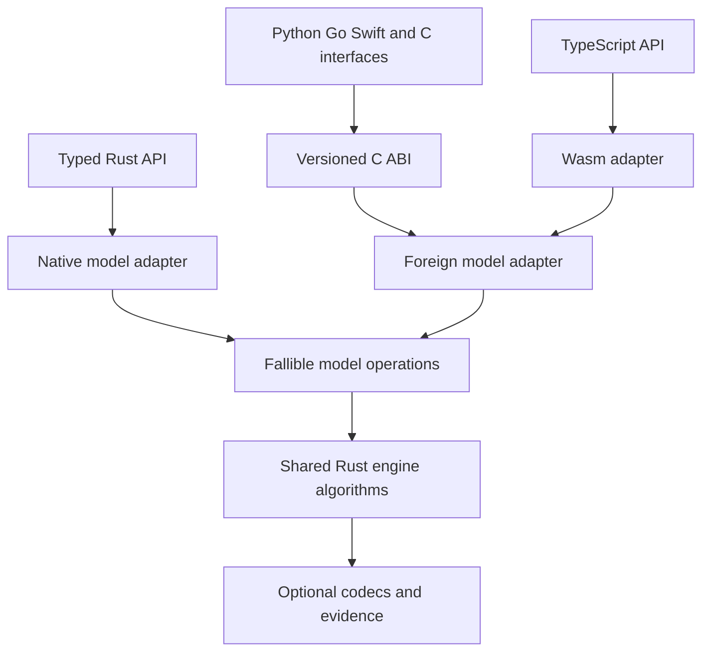

# ABI v2 architecture and migration plan

Status: implementation in progress; runtime qualification and measurements explicitly pending. Date: October 12, 2026.

Make Rust the shared production engine behind idiomatic Python, Go, TypeScript,
Swift, and C interfaces. Replace the byte-only foreign adapter with a versioned
interface that supports application-owned values, optional persistence, explicit
callback errors, and measured resource costs. Preserve direct Rust APIs and the
existing search, checking, recording, and replay algorithms.

Build and qualify v2 alongside ABI 1 and the independent language engines. Switch
each language separately after its behavior, installation, and performance gates
pass. Retain the portable specification and an independent Python reference for
testing after production engine consolidation.

## Scope and source baseline

This plan uses the October 12 working checkout based on commit
`0949e7992f1be34d2052b22f12b7cbb0ce6b7a95`, including uncommitted work. The commit
alone does not identify the inspected source. Phase P0 must capture a reproducible
baseline before implementation starts.

The isolated `abi/v2-foundation` worktree starts from that committed revision
and carries this plan without importing parallel uncommitted work. See
[implementation status](ABI-V2-STATUS.md) for its current implementation scope and
qualification. References below to improvement documents or newer modules name
integration dependencies in the original checkout, not files shipped here.

The working tree contains parallel assurance, lifecycle, network, evidence, and
qualification work. In particular, `src/evidence.rs` there already
contains a proposed format 2 envelope around existing exact traces. Integrate
with that work; ABI version 2 does not imply a new trace format or authorize
replacing that implementation. Preserve the supplied
`docs/improvement/PLAN.md` roadmap and coordinate changes to shared files.

| Existing surface | What the replacement must preserve or improve |
| --- | --- |
| [Rust model contract](../src/model.rs) | Application-owned values; optional codecs; deterministic ordered observations; efficient direct Rust use. |
| [ABI 1](../src/ffi.rs) and [C header](../bindings/c/stateless.h) | Existing consumers of byte-model record, replay, and enumeration continue to work during migration. |
| [Independent engines](../PORTABLE.md) | Four portable profiles, typed callbacks, custom equality, optional persistence, and language-specific ergonomics. |
| [Portable specification](../spec/README.md) | Reviewed semantics and expectations remain authoritative independently of the Rust implementation. |
| [Runtime observation](../src/execution.rs) | Checking an observed transition never reruns the reducer or executes effects. |
| [Go bridge](../bindings/go/README.md) | Explicit lifetimes, thread confinement, contained callback failures, exact native engine identity, and fresh-process replay. |
| Parallel qualification and benchmark work | Integrate `docs/improvement/STATUS.md` and `docs/benchmarks.md`; compile-only results remain distinct from executed tests and measurements. |

The rewrite covers the foreign interface, safe language wrappers, packaging, and
the core extension points needed for foreign operations. It preserves the
dependency-free Rust core and handwritten Rust model APIs. Translating application
source into Rust, executing application effects, distributed search, arbitrary
asynchronous callbacks, and universal Rust feature parity are outside the first
release.

## Target architecture

Native and Wasm builds share algorithms and semantic contracts. They have separate
transport layouts and runtime instances. Handles from different sessions, engine
copies, or Wasm instances are never interchangeable.

Keep the current public Rust entry points as generic adapters to the shared
implementation. Native calls should remain statically dispatched where they are
today. Foreign callbacks incur dynamic dispatch at the boundary. Do not make
ordinary Rust models allocate host registries or serialize values to use the
shared implementation.

## Contract decisions

### Values and ownership

Provide two model representations under the same operation contract:

- **Host values:** language wrappers retain state, input, and output objects in
  session-owned registries. Rust retains opaque tokens through shared owners.
  Host values are the initial route for preserving native modeling APIs.
- **Byte values:** application-defined canonical bytes remain supported for
  compact models, existing integrations, and cases where measurements favor them.
  Byte values use the same engine rather than a second search implementation.

Retained values must be immutable snapshots. For mutable application types, the
wrapper makes the required semantic copy at an explicit, fallible snapshot
operation. A reference-count increment does not establish snapshot isolation.
Borrowed callback arguments last only for their documented call; retaining one
requires promotion to an owned snapshot.

Rust cloning of an admitted host value clones its shared owner without calling
foreign code. Final release removes the wrapper's root on the owning thread.
Release is a nonthrowing bookkeeping operation; wrappers contain runtime
finalizer exceptions and prevent engine reentry. Cleanup must remain valid on
callback failure, cancellation, bounds, and session teardown.

Use session-scoped tokens with generation checks and explicit kind validation.
Zero is invalid. Handle identity is never semantic state equality. The wrapper
must retain real GC roots or language ownership references; Rust must not retain
unrooted object pointers. Go's [runtime/cgo.Handle](https://pkg.go.dev/runtime/cgo)
is the appropriate existing mechanism for rooting Go values through C.

Session-owned result handles may contain witnesses without requiring codecs.
They remain valid until released or until session closure. Safe wrappers extract
owned language results before closing the session. Closing a session invalidates
its subordinate handles and releases cursors, reports, and values before the
model context. Specify and test acquisition and release order for each callback
result, including a partially constructed result that fails before publication.

Opaque tokens can be checked; arbitrary invalid C pointers cannot be made safe.
Raw byte spans remain subject to the caller's pointer and lifetime obligations.

### Fallible operations inside the engine

Introduce an internal model-operations interface whose foreign operations return
structured errors. It must cover snapshot creation, state and input comparison,
optional state hashing, input cursor advancement, generation, simplification,
checks, codecs, and optional feedback. Native adapters delegate to existing traits
and wrap successful infallible operations in the result type.

The engine algorithms consume that interface. Avoid implementing a second BFS,
replayer, or shrinker in the ABI layer. Preserve existing native entry points and
their bounds wherever possible; establish any necessary Rust source break as an
explicit release decision before implementation, rather than an incidental
consequence of wrapper work.

Move shared report and observer plumbing onto the same interface where it is
currently constrained by public `Model`. This includes search observers, checked
initial/transition views, and replay observations/errors. Adapt internal views
back to unchanged native public types. Prove the path with synthetic state,
input, and output types that deliberately implement neither `Eq` nor `Hash`.
A proxy with token-based `Eq` would conceal an incomplete refactor.

The current `Model` requires `Clone + Eq`, BFS additionally uses `Hash`, and input
iteration yields values without a per-item error channel. Foreign operations
must not be hidden inside those infallible traits. Specifically:

- Comparison or hash failure aborts the operation with a model error. It never
  becomes `false`, zero, a new state, or a passing result.
- Hash collisions always resolve through semantic equality. A model may omit
  hashing and use equality-only lookup.
- Input equality must work in causal validation and shrink candidate deduplication.
- Input and simplification cursors can fail after yielding earlier values.
- Automatic finite-domain generation commits its sampled input and RNG state only
  after a successful scan; cursor failure must not publish a partial sample.
- Optional guided feedback needs its own failure channel; native-only feature
  traits do not automatically qualify foreign guided search.

Audit direct equality, hashing, iteration, and simplification in `explore`,
`automatic`, `guided`, oracle/composition adapters, and debugger sessions. Route
every operation in an advertised foreign capability through the checked path.

Precomputed exact semantic keys are an optional optimization after the general
comparison path works. They must preserve the application's equivalence relation
and resolve collisions exactly. A digest alone, a token, or persistence bytes
that encode irrelevant differences cannot replace semantic equality silently.

### Persistence and runtime observation

Execution, checking, and BFS on host values require no codec. Recording, durable
replay, and evidence export negotiate codec support explicitly. Codecs preserve
exact historical values even when search equality intentionally ignores a field.
Only the model author can justify that such equality preserves future behavior
and properties.

Provide separate initial-check and observed-transition entry points. An observed
transition supplies its actual before-state, input, next-state, ordered outputs,
disposition, and sequence. Observation failure returns diagnostic information
without replacing the application's completed result or invoking its reducer.

Reuse existing exact recording, replay, and ring-recording semantics. Retain
model, property, codec, and build identities. Treat package version, ABI version,
portable profile version, binary trace version, and evidence-envelope version as
independent compatibility dimensions.

Preserve `trace-json-v1` as a separate interchange contract, including strict
decoding and existing replay behavior. The current Rust corpus adapter has
fixture-specific JSON translation; it is not a general conversion API. Factor
shared recording/replay machinery as needed instead of copying its engine logic
into each wrapper. JSON syntax adapters may live in the language SDKs. Do not
claim a lossless conversion between portable envelopes and richer binary evidence
when the original artifact lacks required fields or provenance.

### Input cursors and bounded work

Define cursor creation, `next`, end, error, and close as distinct operations.
A cursor retains its source snapshot for its lifetime. Close it exactly once on
normal completion, early termination, callback error, cancellation, and session
closure. Preserve input order and duplicate entries.

Match the portable BFS boundary probes: a domain exhausted exactly at a limit
differs from a domain with unexamined inputs. A failure from `next` must not look
like exhaustion. Start with one-item advancement. Add bounded batching only if
it preserves the same probe, error, ordering, and count semantics; eager prefetch
must not execute callbacks beyond what the operation permits.

Retained handle counts, output counts, buffer bytes, and encoded evidence have
explicit limits. Host object size estimates remain estimates. These limits cannot
bound arbitrary callback allocation or establish a process RSS cap.

### ABI layout and error handling

Use `extern "C"` for native entry points and C-compatible data layouts. Rust's
native ABI has no stability guarantee; see the
[Rust Reference](https://doc.rust-lang.org/reference/items/external-blocks.html#abi).
Use a new `stateless_v2_*` symbol family and a separate v2 header. Preserve ABI 1
symbols and its version query while both versions ship in one library.

Specify a small bootstrap API, size/version-tagged descriptors, and optional
capability tables. Registration checks required callbacks and supported layout
sizes before retaining context. Reject unknown required flags; define how larger
known-prefix descriptors and optional capabilities are negotiated. Feature
availability must be queryable without invoking an unsupported operation.

Return explicit status plus bounded structured error data: category, operation,
callback phase, sequence when known, and diagnostic text. Separate property
findings, replay divergence, identity mismatch, unsupported capability, resource
termination, and callback/adapter failure. Publish completed results atomically;
partial check batches remain diagnostics and cannot count as complete evidence.

Builder failures latch for the current callback invocation. An ignored append,
invalid-token, or quota error still makes that invocation fail even if the host
returns success. Commit rechecks the latched result and releases partial values.
This supplements the explicit error return; it does not conceal semantic callback
failures inside infallible equality or iteration operations.

Catch recoverable host exceptions inside each language shim and ordinary Rust
unwinds inside native entry points. No exception crosses the C boundary. Do not
claim recovery from process aborts, invalid pointers, or arbitrary Wasm traps.
These ownership and unwind constraints follow the
[Rust FFI guidance](https://doc.rust-lang.org/nomicon/ffi.html).

Start with synchronous, thread-confined sessions. Prohibit nested engine runs,
session closure, model reconfiguration, and other unlisted reentry into the same
session, including from cleanup. Explicitly allow callback-scoped services for
result builders, value publication, diagnostics, and generation RNG access through
invocation-bound tokens. These services cannot start engine work or outlive the
callback. A cancellation token may be signaled externally without accessing model
handles.
Cancellation is cooperative between callbacks and cannot interrupt an arbitrary
callback. A synchronous browser main-thread call cannot process a UI cancel event
while blocked; use a worker for responsive integration and report forced worker
termination as interruption, not a completed search.

Wasm uses explicit integer tokens and a documented linear-memory wire layout,
not a copy of platform C struct offsets. Keep memory growth/view invalidation,
64-bit integer transport, initialization, and instance ownership in the JS shim.

### Hot path optimization

Use reusable result storage and bounded append sinks for checks, outputs, and
encoded data. Avoid formatting diagnostics on passing paths where practical.
Measure registry access, rooting, snapshot copying, equality, and callback counts
separately from engine time.

Optional combined transition/check callbacks follow the baseline implementation.
They must preserve initial checking, check phases and order, skipped observations,
partial-error behavior, and effect-once semantics. Runtime observation always
retains its separate entry point. Exact evidence still costs encoding and storage;
the handle representation does not remove that work.

## Capability and migration scope

Capabilities describe model hooks and engine operations separately. A model with
no codecs can explore; a wrapper with a record method cannot record that model.

| Capability | Release stage | Required behavior |
| --- | --- | --- |
| Initialization, checking, observation | First complete slice | Typed values, explicit errors, policy skips, no reducer reexecution. |
| Finite BFS | First complete slice | Exact custom equality, collision handling, lazy fallible inputs, deterministic counts and witnesses. |
| Binary recording and replay | First complete slice | Optional codecs, identity checks, fresh-process replay and precise divergence. |
| All four portable v1 profiles | Before any native engine replacement | Include RNG and JSON trace semantics; preserve existing exported behavior or document a versioned API change. |
| Generic generation, fuzzing, shrinking | First consolidated production release | Fallible generation/simplification, causality, input equality, deterministic seeds, saved original and reduced witnesses. |
| Runtime ring recording | First consolidated production release | Observe actual transitions, bounded retention, checkpoint continuity, explicit recording failure. |
| Guided search and foreign oracles | Follow-on capability | Complete fallible feedback/composition integration and independently qualified behavior. |
| Campaigns and debugger integration | Follow-on capability | Explicit worker/session ownership and inspection protocols; no automatic claim from core availability. |
| Broader network, lifecycle, assurance helpers | Separately scoped | Integrate with the current improvement work and its own contracts. |

The advanced capabilities are additions to the portable subset, not new v1
profile requirements. Keep support descriptions precise about which model kinds,
operations, and runtimes are qualified.

Campaigns need a separate design: existing reports require inputs that can cross
threads, while session-owned host handles cannot. Worker-local contexts plus
owned exportable results are a candidate. Never mark a host handle `Send` merely
to satisfy the existing Rust campaign signature.

## Implementation phases

Each phase ends with a reviewable artifact and an exit gate. Effort labels are
relative work size, not calendar promises. A failed gate leaves the affected
backend opt-in while the established backend remains available.

| Phase | Work | Depends on | Effort |
| --- | --- | --- | --- |
| P0 | Freeze baseline, compatibility inventory, and measurement cases | Existing checkout integration | Medium |
| P1 | Specify v2 and establish fallible core operations | P0 | Large |
| P2 | Implement C ABI and the complete engine slice | P1 | Large |
| P3 | Qualify Go and TypeScript/Wasm pilot wrappers | P2 | Large |
| P4 | Complete portable parity, Python/Swift, and production operations | P3 contract review | Large |
| P5 | Qualify artifacts, platforms, and performance | P3 and applicable P4 work | Large |
| P6 | Switch defaults and retire redundant engines incrementally | Per-language P4 and P5 gates | Medium |

### P0 Baseline and acceptance inventory

Capture HEAD, dirty-source hashes, toolchains, native/Wasm binary identities, and
package bytes in a new receipt directory. Inventory exported APIs and every
claimed platform for each existing package. Include installation behavior,
synchronous versus asynchronous initialization, errors, codecs, snapshot copying,
equality, iteration, trace readers, and RNG behavior.

Decide the distribution strategy before freezing the ABI: static versus shared
linkage, library discovery, per-target artifacts, Go `CGO_ENABLED=0` and cross-
compilation, compiler-free Python wheel installation, and Swift loading. Record
which deployment contracts v2 can preserve and which need a versioned change or
continued legacy backend. OS support alone does not establish deployment parity.

Extend the existing benchmark harness with matched workloads for native Rust,
each independent engine, ABI 1 where supported, and the future v2 representations.
Record expected outputs, bounds, work counts, and fixed seeds beside workloads.
Choose numeric performance budgets from repeated baseline measurements before
using them to evaluate optimization. If runtime execution is unavailable, baseline
measurement remains an unmet gate; compile results do not fill it.

Exit: reproducible source baseline; explicit API/platform compatibility matrix;
reviewed workload fixtures; baseline receipts and declared regression budgets
for the implementation environment. Do not modify unrelated worktree changes.

### P1 Contract and core extension points

Write the normative v2 contract, C declarations, Wasm layout, capability tables,
ownership diagrams, and error/termination mapping. Settle result lifetime and
backend selection before porting applications. Proposed new locations are
`docs/ABI-V2.md`, `bindings/c/stateless_v2.h`, and `src/ffi_v2/`; these names describe
planned artifacts, not implemented APIs.

Introduce shared fallible operations and adapt native Rust execution, observation,
BFS, and record/replay to them. Add a foreign-model test adapter that injects
comparison, hash, snapshot, and cursor failures using values without `Eq`/`Hash`.
Refactor the shared observer/report plumbing so this adapter runs the actual
algorithms. Identify every remaining direct trait call needed by later advertised
capabilities.

Exit: the same Rust algorithms run through both adapters; current native tests
and corpus results retain behavior; callback failures remain model errors;
native-path measurements stay within P0 budgets. No foreign comparison or cursor
error is represented as equality, exhaustion, or a successful report.

### P2 C ABI and engine integration

Implement session/registry management, version negotiation, typed value tokens,
bounded builders, model registration, cursors, errors, reports, and byte-model
adaptation. Expose initial checks, observation, BFS, and binary record/replay.
Ship ABI 1 and v2 through one matching engine build, with new build identities
when source changes. Never exchange handles between independently loaded copies.

Build real C consumers against the exported header and library. Exercise mutable
state isolation, distinct handles for equal states, deliberate hash collisions,
codec-free search, observed transitions, interrupted construction, cursor cleanup,
ignored builder errors, and fresh-process replay. Run boundary/sanitizer checks
on supported toolchains.

Exit: complete C workflow passes, ownership counts return to baseline, callback
failures publish no completed success, and an unchanged ABI 1 consumer still works.

### P3 Go and TypeScript pilots

Implement Go using explicit cgo handles and scoped OS-thread ownership. Implement
the TS wrapper with typed model interfaces, an instance-owned host object registry,
and explicit asynchronous engine initialization followed by synchronous operations.
Test the initialization change as part of API compatibility; do not silently turn
existing synchronous model methods into promises.

Run both on counter, cancellation/stale-completion, large immutable state, mutable
state, and broad input-domain fixtures. Run applicable declared-capability cases
from the portable corpus against independent engines, with reviewed expectations
controlling disagreements. Record unsupported cases explicitly; this slice does
not claim complete four-profile conformance before RNG and JSON support exist.
Exercise Node and a real browser separately. Check worker integration and memory
growth in the browser; Node execution is not browser qualification.

Exit: both wrappers complete observation, search, record, reload, exact replay,
and deliberate divergence. Retained object counts recover on success and failure.
Initial throughput/allocation/peak-memory comparisons expose representation costs.
Review the contract before investing in the remaining wrappers.

### P4 Parity and production capabilities

Bring Go/TS and new Python/Swift wrappers to all four portable profiles. Preserve
native application types, custom equality, optional codecs, lazy iteration,
errors, Unicode identity, and trace behavior. Extend `conformance/run.py` to label
independent engines and Rust-backed adapters accurately while testing both.

Add generic foreign generation, enabled-input checks, simplification, fuzzing,
shrinking, and runtime ring recording. Finish the core fallibility audit for
those paths, including `automatic` and shrink candidate deduplication. Preserve
original/minimized evidence, precise failure identities, and fresh-process replay.

For Python, prototype a standard-library FFI shim against the C ABI first and
measure callback overhead; use a thin compiled shim if that approach misses the
budgets. Keep either choice outside ordinary Rust dependencies. Swift uses a
typed wrapper with explicit reference ownership and contained throws.

Exit: installed wrappers pass required profiles and real typed-model consumers;
new operations have independent properties and injected-fault coverage. Existing
JSON fixtures still replay. Require the complete unfiltered four-profile suite
before a native engine replacement. Unsupported advanced operations remain explicit.

### P5 Distribution and performance qualification

Produce native libraries, headers, Wasm, and SDK packages from the same source
identity. Extend `scripts/build-bindings.py` and consumer checks instead of adding
an unrelated packaging pipeline. Verify relocatable fresh installations outside
the checkout, including wrong-library, missing-library, and version-mismatch
failures. Defeat language build caches that do not track external native bytes.

Add a focused C/Go/Wasm v2 PR gate as soon as P3 runs end to end. Keep full native,
Wasm/browser, supported runtime, and minimum-Rust-version matrices as scheduled
and release gates, with all required cells passing on the release candidate.
Qualify package consumers as well as source tests; a skipped matrix cell remains
unqualified. Ordinary Rust build/test paths must not acquire a mandatory Go,
Python, JS, or Swift toolchain dependency.

Run the documented OS/architecture/runtime matrix. Native C/Go/Python targets,
Swift targets, and browser support have separate receipts; expanding a platform
list requires an executed consumer check. The root Swift package declares Apple
mobile platforms, so the inventory must explicitly resolve them before replacing
that product. Keep an established backend for any platform or deployment mode v2
cannot yet support, including no-cgo consumers during the migration period.

Publish complete mode comparisons with semantic work counts and memory breakdowns.
Measure cold load/initialization separately from warm operation costs. Select
defaults by evidence; host handles and byte models can each win different cases.

Exit: every proposed default has a verified installed artifact, completed runtime
qualification, historical trace compatibility evidence, and measured performance
within its declared budgets. CI configuration or successful compilation alone
does not meet this gate.

### P6 Default changes and retirement

Start with explicit opt-in backend selection and no silent fallback. Keep imports
and model APIs stable where possible; initialization, deployment dependencies,
or unavoidable source breaks receive a documented package version change.
Record which backend and engine build produced each diagnostic receipt.

Switch each language only after its gates pass. Retain its previous backend for
at least one documented migration release and maintain a tested rollback route.
Missing native binaries or unsupported platforms must produce an actionable
error, not select a different engine invisibly.

After the migration window, remove duplicate production algorithms and their
obsolete release jobs. Keep API/adapter tests, golden cases, mutation controls,
portable readers, and a small independently implemented Python reference package
for tests. Its reference profile scope can remain frozen without becoming another
production implementation of every advanced Rust feature.

Deprecate ABI 1 separately from independent engines: one consumer group does not
establish readiness for the other. Remove its symbols only in an explicit breaking
release after supported consumers have migrated. Ordinary package upgrades must
not silently invalidate durable evidence.

Exit: each retired implementation has a documented replacement, migration and
rollback instructions, matched supported-platform coverage, and passing installed
consumer/replay receipts. Update support and capability documentation to the
actual shipped scope.

## Qualification gates

| Area | Required cases |
| --- | --- |
| Portable behavior | Initial failure, rejected/ignored steps, ordered and duplicate checks/outputs/inputs, skipped checks, boundary probes, known-state failing edges, exact counts and termination. |
| Contract differences | Empty property IDs/reasons allowed by the portable spec; exact Unicode identity; full-width RNG; custom equality separate from codec bytes. ABI 1 packet validation must not define v2 semantics. |
| Snapshot isolation | Mutable nested objects, shared immutable data, retained predecessor states, inputs mutated by callbacks, and results surviving safe-wrapper extraction. |
| Fallibility | Errors during initial/step/check/clone-or-snapshot/hash/equality/next/generation/simplification/codec callbacks; ignored builder errors; failed automatic scans preserve RNG state; no fake EOF or completed success. |
| Ownership | Partial construction, repeated disposal, wrong session/kind/generation, reentry, wrong-thread use, forced GC, cursor cleanup, cancellation, and outstanding results at close. |
| Observation | Reducer execution counter stays unchanged during checks; observation failure preserves the actual transition; periodic policies retain explicit skips. |
| Evidence | Binary and portable JSON producer/consumer matrices; exact fresh-process replay; incompatible identities; deliberate first divergence; malformed and oversized artifacts. |
| Advanced operations | Shrink causality and input equality, original/reduced witness validity, fixed RNG seeds, recorder eviction/checkpoint continuity, and capability rejection. |
| Integration | ABI 1 and v2 coexistence, C header layout checks, relocated installs, actual browser behavior, native library identity mismatch, and runtime/architecture mismatch. |
| Independent assurance | Reviewed golden expectations and the Python reference detect seeded engine defects; adapter tests detect ownership/encoding defects. A crash alone does not count as semantic mutation detection. |

Use [the conformance kit](../conformance/README.md),
`scripts/check-native-ports.py`, `scripts/check-go.sh`, `scripts/check-native.py`,
`scripts/check-js-package.mjs`, and Rust tests as foundations. Extend their
coverage for v2 and retain raw logs with exact source and artifact identities.
Do not describe wrappers calling one Rust binary as independent engine validation.

## Performance acceptance

| Workload | Comparisons and measurements |
| --- | --- |
| Small state and cheap transitions | Crossings per transition, warm throughput, allocation count/bytes, and callback/registry cost. |
| Large states and small changes | Mutable-copy and immutable-sharing cases; encoded byte volume, snapshot copies, host heap, Rust heap, Wasm memory, and process peak RSS. |
| Branching and cyclic BFS | Equality/hash cost, collision-heavy lookup, retained states, early bounds, lazy-domain allocation, and failure witness length. |
| Runtime observation | Checks only, periodic checks, and recording separately; application reducer called exactly once. |
| Recording and replay | Encode/decode costs, trace bytes, ring eviction, fresh-process replay, original/minimized evidence. |
| Package startup and repeated sessions | Import/load/instantiate latency, artifact size, repeated teardown, host roots, and long-run memory trend after GC/allocator effects. |

Compare identical semantics, bounds, seeds, and executed work. Separate unrecorded
search from exact recording. Measure native Rust before and after the core change,
each independent engine before replacement, ABI 1 where comparable, and v2 byte
and host-value representations. Avoid a single aggregate speedup number.

Store repeated samples, workload identity, toolchains, compiler profile, machine,
runtime versions, binary hashes, and variance. Rust allocator probes alone miss
host and Wasm allocations. Stable handle counts are necessary but insufficient
evidence of stable process memory.

P0 fixes regression budgets after observing baseline noise. P5 fails a proposed
default when it exceeds those budgets; changing a budget requires a documented
workload-specific tradeoff and a new comparison. No speedup, zero-copy, zero-
allocation, or native-memory-parity claim is a prerequisite assumption.

Follow the captured [local qualification policy](ABI-V2-STATUS.md) and integrate
the parallel benchmark instructions: Rust execution and measurements belong
in an execution-permitted environment. Compile-only receipts remain incomplete
performance and runtime evidence. This plan does not change shared Kyoto policy.

## Parallel work and integration

Assign one integration owner for the contract and shared core changes. After P0,
contract/core design, workload preparation, and package/platform inventory can
proceed in parallel. P2 establishes the C and Wasm contract used by the Go and TS
pilot work. Python and Swift can proceed in parallel after the pilot contract
review; portable trace compatibility and advanced operations are separate streams.
Packaging work can begin early, but final artifacts depend on a frozen candidate.

| Workstream | Primary files and coordination |
| --- | --- |
| Core operations | `src/model.rs`, `execution.rs`, `explore.rs`, `automatic.rs`, `guided.rs`, `monitor.rs`; coordinate with current optimization and evidence work. |
| ABI runtime | Proposed `src/ffi_v2/` and `bindings/c/stateless_v2.h`; preserve `src/ffi.rs` and v1 exports. |
| Language wrappers | `bindings/go/`, `bindings/browser/`, `bindings/swift/`; add Python binding support and integrate existing public native packages only after parity. |
| Portable compatibility | `spec/`, `conformance/`, `validation/corpus/`; separate codec/syntax adaptation from shared engine algorithms. |
| Distribution and evidence | `scripts/build-bindings.py`, consumer scripts, workflow matrices, benchmark receipts, `RELEASING.md`, and `SUPPORT.md`. |
| Adoption documentation | `README.md`, `PORTABLE.md`, package READMEs, and the generator behind `docs/CAPABILITIES.md`; preserve generated-document ownership. |

Sequence changes to shared core files and workflow files through the integration
owner. Coordinate with A04/A05/A09/A11 work; the ABI program replaces the need to
independently reimplement advanced Rust algorithms under A12, while retaining the
portable specification and its qualification requirements.

## Decisions to resolve through the first experiments

The architectural defaults are host snapshots plus an optional byte path,
fallible shared operations, optional codecs, synchronous confined sessions, and
per-language migration. Experiments resolve narrower implementation choices:

1. Measure snapshot/registry costs against byte values before selecting SDK
   defaults or adding combined callbacks.
2. Select Python shim technology after exercising callback errors, lifetime
   management, installed wheels, and representative throughput.
3. Confirm whether explicit Wasm initialization is acceptable within the existing
   TS package API or requires a distinct entry point and versioned migration.
4. Establish native artifact targets and Swift mobile coverage from actual
   consumers; preserve existing backends for unmet targets.
5. Qualify evidence-envelope support independently of ABI numbering and integrate
   with the in-progress evidence implementation before promising format coverage.

The first implementation increment is P0 plus the P1 contract and fallibility
proof. Engine retirement starts only after a complete, qualified replacement is
available for the affected language and platform.
